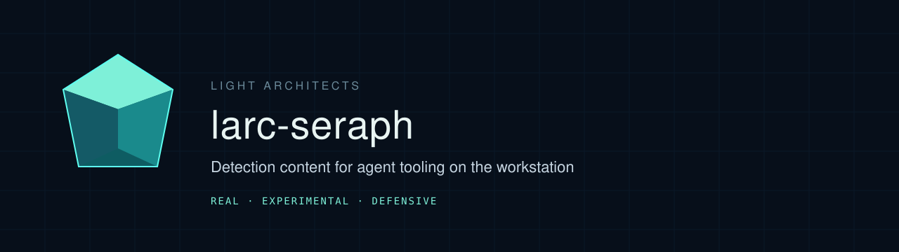

# larc-seraph

[](https://github.com/theLightArchitect/larc-seraph/actions/workflows/test.yml)
[](https://github.com/theLightArchitect/larc-seraph/releases)
[](LICENSE)
[](LICENSE.rules)

Defensive detection content for AI-agent tooling on developer workstations, written by Kevin Francis Tan / Light Architects ([lightarchitects.ai](https://lightarchitects.ai)).

The release badge stays empty until a maintainer pushes a `vX.Y.Z` tag. v0.1.9 prepares that workflow. It does not publish the release by itself.

Rule IDs stay in the `SERAPH-YARA` and `SERAPH-SIGMA` series. The pack name is larc-seraph.

YARA rules for the files an agent trusts. Sigma rules for the macOS events those files become. Synthetic fixtures and a pytest harness so a match means what the catalog says it means.

The docs site is [docs/index.html](docs/index.html). The threat model and field contract are [docs/content/threat-model.md](docs/content/threat-model.md).

## What this is

Seventeen experimental rules:

| ID | Engine | What it watches |
| --- | --- | --- |
| `SERAPH_MCP_Launch_From_Temp` | YARA | MCP command launched from a temp or cache path |
| `SERAPH_MCP_Curl_Pipe_Shell` | YARA | MCP config pipes a fetch into a shell |
| `SERAPH_MCP_Encoded_Exec` | YARA | MCP config decodes into a shell or eval |
| `SERAPH_MCP_Remote_Npx` | YARA | npx or uvx from a URL, `github:` specifier, or `@latest` |
| `SERAPH_MCP_Unpinned_Package` | YARA | npx or uvx package with no numeric version |
| `SERAPH_MCP_Secret_Exfil` | YARA | A token variable interpolated into a URL or a fetch |
| `SERAPH_Instruction_Hidden_Unicode` | YARA | Unicode tags or bidi overrides in instruction files |
| `SERAPH_Instruction_Unsafe_Directive` | YARA | Confirmation bypass, or a credential path next to a sink |
| `SERAPH_LaunchPlist_Writable_Interpreter` | YARA | RunAtLoad, KeepAlive, a shell, and a user-writable path |
| `SERAPH_LaunchPlist_SSH_Reverse_Tunnel` | YARA | Reverse SSH in a plist with host-key checking disabled |
| `SERAPH_Git_Hook_Suspicious_Exec` | YARA | Hook decodes into a shell, or posts a credential path |
| `SERAPH_MacOS_Agent_Writes_Authorized_Keys` | Sigma | Agent host writes `authorized_keys` |
| `SERAPH_MacOS_Agent_Modifies_Shell_RC` | Sigma | Agent host writes a user shell startup file |
| `SERAPH_MacOS_Interpreter_Drops_Launch_Plist` | Sigma | Interpreter writes a LaunchAgent or LaunchDaemon plist |
| `SERAPH_MacOS_SSH_Reverse_Lax_HostKey` | Sigma | ssh reverse forward with host-key checking disabled |
| `SERAPH_MacOS_Agent_Piped_Shell` | Sigma | Agent parent spawns a fetch or decode handed to a shell |
| `SERAPH_MacOS_Terminal_Piped_Shell` | Sigma | Terminal or iTerm parent spawns a fetch or decode handed to a shell |

Each rule carries author, date (2026-11-13), ATT&CK mapping, severity, scope, and a false-positive note. Status is experimental.

## What this is not

This is not an EDR, a blocker, or a claim of coverage. It is not offensive tooling. Fixtures under `tests/fixtures/` are synthetic and inert, labelled `synthetic-benign`, and use `example.invalid` where a host appears. Do not execute them. A green test run proves the fixtures and the rule metadata. It does not prove a fleet false-positive rate.

Sigma rules assume a normalized macOS field contract (`Image`, `CommandLine`, `ParentImage`, `TargetFilename`, `User`). They do not match raw Apple unified logs until a translator maps Endpoint Security events onto those names. The threat model states that limit in full.

`SERAPH-YARA-016` flags an unpinned registry package inside a JSON, TOML, or YAML MCP config. `@modelcontextprotocol`, `@anthropic`, and `@github` are allowlisted. A numeric version pin is not a match. A Markdown README that only quotes the config is not a match.

## Quick start

Python 3.11 or newer. A full `pytest` run also needs `yarac` 4.5.x and the yara-x `yr` CLI on `PATH`. Without them the fixture tests that only need `yara-python` still run, and the compile tests fail.

```bash
python -m venv .venv
source .venv/bin/activate
pip install -e ".[test]"
pytest
larc-seraph path/to/mcp.json
```

The scanner prints matches. It does not block, quarantine, or send telemetry.

How to run the metadata check, `sigma check`, the benign-corpus scan, and the doc generator is in [CONTRIBUTING.md](CONTRIBUTING.md).

## Consume the rules

Pass `filepath` as the path is stored. Use forward slashes. Quote the yara-x define so the shell does not eat the quotes.

```bash
yara -d filepath=/abs/path rules/yara /abs/path
yr scan --define 'filepath="/abs/path"' rules/yara /abs/path
```

```python
rules.match(path, externals={"filepath": path})
```

`larc-seraph path/to/AGENTS.md` sets that external itself.

Sigma rules match the normalized macOS field contract, not raw unified logs. Convert them with sigma-cli, or use the queries already in `rules/converted/`:

```bash
sigma convert -t lucene -p pipelines/ecs-macos.yml -od rules/converted/lucene -ot '{stem}.txt' rules/sigma
sigma convert -t splunk -p pipelines/splunk-macos.yml -od rules/converted/splunk -ot '{stem}.txt' rules/sigma
```

Lucene output uses Elastic Common Schema names (`process.executable`, `process.command_line`, `file.path`). Splunk output uses the names in `pipelines/splunk-macos.yml` (`process_path`, `parent_process_path`). A pipeline is required. The default sigma field names are not this pack's contract.

Tagged releases attach a zip and a tarball of the rules, the converted queries, `validation/fp-allowlist.txt`, and the license files, plus `SHA256SUMS`. Check the sums before you copy the rules into a product.

## Run the tests

```bash
pip install -e ".[test]"
pytest
python tools/check_rule_metadata.py
```

`pytest` compiles the YARA pack, checks every positive and negative fixture, evaluates the Sigma rules through pySigma's condition tree, and runs `sigma check --fail-on-issues`. The ATT&CK tag check downloads MITRE's published STIX once and caches it. `pytest` fails if `yarac` or `yr` is not installed.

Regenerate the HTML site after a rule or write-up change:

```bash
python -m larc_seraph.docsgen
python -m larc_seraph.docsgen --check
```

Open `docs/index.html` in a browser. It is a static site. No server is required. The visual language is Galaxy Opal: a cool-teal solid on a navy void. The canonical reference image is `docs/assets/galaxy-opal-canonical.png`. The system card is `docs/design/galaxy-opal-system-card.md`.

Try one file locally:

```bash
larc-seraph path/to/mcp.json
larc-seraph --sigma tests/fixtures/sigma/known_good/agent_pytest.json
```

The scanner prints matches and does not block, quarantine, or send telemetry. It sets the `filepath` external to the path you passed, with backslashes turned into forward slashes and the original case kept.

## Scanner contract

Rules that care about a path read the external string `filepath`. An empty value means the scanner did not say where the bytes came from. Instruction rules and the git-hook rule then do not match. MCP rules still match a file whose first byte is `{`.

Pass the path as it is stored. The regexes are case-insensitive. `AGENTS.md` and `Agents.md` are the same gate. The commands are in [Consume the rules](#consume-the-rules). Use forward slashes in the value.

Telemetry normalizers for eslogger JSON, Elastic Common Schema, and osquery rows live in `larc_seraph/translate.py`. pySigma pipelines in `pipelines/` emit Lucene and Splunk queries with those field names. Converted queries are in `rules/converted/`.

## Known limitations

These are the misses recorded in [validation/evasion-matrix.yml](validation/evasion-matrix.yml). The methodology and the numbers are in [VALIDATION.md](VALIDATION.md). A numeric version pin is a non-match on purpose, and so is a backticked status-bar label.

- A fetch or `base64` whose name is split (`ba''se64`) or stored in a variable, so the file never contains the word.
- A package name that is not one JSON string, and a remote specifier more than 160 bytes after `npx`, `uvx`, or `npm exec`.
- A bare `/tmp` grant with no further path segment.
- A secret variable that is not on the short name list.
- A zero-width mark between every letter of a confirmation-bypass sentence. A mark between the words is caught. U+200B with no other hidden-text signal is not. "Never request permission" needs a nearby high-risk action such as a shell command, `rm`, `publish`, or `git push`. Listing, reading, viewing, searching, `ls`, and `git status`, `log`, or `diff` do not count. A Markdown heading, a table row, or a known permission flag such as `--yolo` does not match. `--force` on an ordinary instruction line does not veto it.
- Homoglyphs other than Cyrillic `o` in that same sentence.
- `KeepAlive` set to the integer 1, and an SSH `-R` glued to its value with no space. A host-key option that lives only in `~/.ssh/config` is not in the plist.
- A git hook with no shebang.
- Shell startup files the path list does not name, such as Fish `config.fish`. `authorized_keys.bak` is not in the path list. A project file that still ends in `.zshrc` does match.
- A plist that is not under LaunchAgents or LaunchDaemons.
- An MCP file that contains both a pinned package and an unpinned one can suppress `SERAPH-YARA-016`, because a numeric version anywhere in the file clears it.
- osquery rows that only have a parent pid. The normalizer leaves `ParentImage` empty, and parent rules do not fire. A piped shell whose parent is launchd is left to the plist rules.
- The benign corpus is a sample of public trees, not every workstation. The Mac scans are summarized in VALIDATION.md.

## Validation

```bash
python tools/fp_scan.py
yr compile rules/yara -o /tmp/larc.yarc
```

`pytest` also runs the evasion matrix, the telemetry round-trip, the conversion check, and the yara-x compile. `sigma check` is described in [VALIDATION.md](VALIDATION.md).

## YARA-Forge

Checked against [YARA-Forge](https://github.com/YARAHQ/yara-forge) `qa/rule_qa.py` and the metadata that pipeline normalizes (`description`, `author`, `date`, `modified`, `reference`, `id`). This is not a claim that the pack is in a forge release.

What lines up:

- The repository is public. Rules are Detection Rule License 1.1, which keeps author attribution on copies.
- No private rules, and no `elf`, `cuckoo`, or `magic` import.
- `yarac --fail-on-warnings` and `yr compile` are clean when the `filepath` external is defined. CI runs both.
- Every YARA rule has the metadata fields above, plus `version` and ATT&CK in `attack_technique` and `attack_tactic`.

What does not:

- Nine of the eleven YARA rules read the external string `filepath`. Forge compiles with no externals. A rule that does not compile there is a critical failure and is dropped. Those nine rules stay out unless a forge build passes `-d filepath=""`. The two LaunchAgent plist rules do not use an external.
- This pack does not set a forge `score` or a sample `hash`. Forge computes a score. These rules are not file-hash malware signatures, so there is no sample hash to put in meta.
- Ids are `SERAPH-YARA-NNN`, not UUIDs. Forge derives a UUIDv5 during normalization.
- This repository is not listed in `yara-forge-config.yml`. Nothing here is in a forge package until a forge maintainer adds it.

yaraQA's string-performance score is not run in this CI. A clean `yarac --fail-on-warnings` is the compile bar this pack claims.

## CI and releases

Pull requests and pushes to `main` run [`.github/workflows/test.yml`](.github/workflows/test.yml): pytest, `yarac --fail-on-warnings`, `yr compile`, `sigma check`, the rule-metadata check, the benign-corpus scan, a docs drift check, gitleaks on the git history, and a `Signed-off-by` check on pull request commits. Actions are pinned by commit SHA. The workflow token can read repository contents.

Pushing a tag `vX.Y.Z` runs those tests and then [`.github/workflows/release.yml`](.github/workflows/release.yml), which publishes the GitHub Release. The release job is the one token that can write contents. Tag the commit yourself after CI on `main` is green. The version in `pyproject.toml` has to match the tag, and `CHANGELOG.md` needs a section for it.

The benign-corpus scan clones public trees at job time. A new hit fails the job. The allowlist is empty. A failed clone also fails the job.

## Project docs

- [SECURITY.md](SECURITY.md) for private vulnerability reports.
- [CONTRIBUTING.md](CONTRIBUTING.md) for rule metadata, fixtures, local tests, and sign-off.
- [CODE_OF_CONDUCT.md](CODE_OF_CONDUCT.md) is Contributor Covenant 2.1.

## License

Two licenses, on purpose.

- Code, the test harness, the scanner, and the docs are [Apache-2.0](LICENSE).
- Rules under `rules/` are the [Detection Rule License 1.1](LICENSE.rules).

DRL is the license detection engineers already exchange. It allows use inside a detection product and requires the author attribution to stay with the rule. CC-BY-4.0 was the other serious option. It is easier to explain to a general audience and a worse fit for someone dropping a Sigma rule into an existing ruleset. Either half can be relicensed by the author.

Copyright 2026 Kevin Francis Tan / Light Architects.
