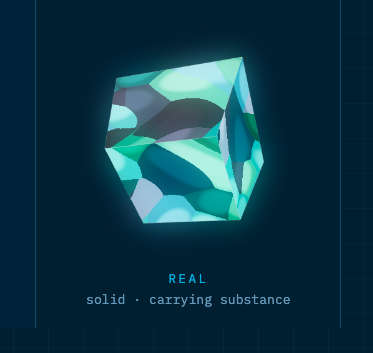

# Galaxy Opal — Claude Design System Card

**Status:** Canonical visual lock (Kevin-stamped)  
**Product:** LightShell TUI / brand substrate  
**Version:** 1.0 · 2026-07-27  
**Reference:** [`assets/galaxy-opal-canonical.png`](../assets/galaxy-opal-canonical.png)  
**Tagline:** `REAL · solid · carrying substance`

> **Give this file to Claude Design.** It is the single source of truth for color, material physics, motion, and component mapping. Prefer this over generic “opal” or “galaxy” moodboards.

---

## 0. One-sentence brand

> A cool-teal **dielectric solid**: light enters a faceted volume, takes a path, and exits as mint-to-deep-teal faces with a soft cyan Fresnel rim — real substance, not surface paint.

---

## 1. Identity lock

| Axis | Locked value | Forbidden drift |
|------|----------------|-----------------|
| **Material class** | Translucent dielectric volume (glass/opal/crystal) | Metal chrome, plastic gloss-only, flat matte chips |
| **Hue band** | Cyan ↔ teal ↔ mint only | Magenta, gold, full rainbow, warm orange primaries |
| **Form** | Faceted polyhedron or facet-implying structure | Pure organic blob with no planar light logic |
| **Stage** | Deep navy void | White paper, busy photo BG, multi-hue gradients |
| **Emotion** | Calm substance, quiet power | Disco neon, aggressive sparkle, cheap iridescence |
| **Truth claim** | `REAL` — physics of light in matter | Decorative sticker / emoji gem |

### Canonical reference



**What the reference proves (non-negotiable reads):**

1. Object has **interior** (not a flat fill).
2. Faces differ by **path length** (mint thin / deep teal thick).
3. Soft **cyan rim bloom** at silhouette.
4. **Narrow chroma** — teal family only.
5. Label language is cool, quiet, technical: *solid · carrying substance*.

---

## 2. Physics model (design from mechanisms)

Design every surface as if a tiny renderer is running:

```
light → enter dielectric → path length + scatter → exit face / Fresnel rim
```

| Mechanism | Visual effect | Design token use |
|-----------|---------------|------------------|
| **Refraction** | Tone shifts per face; BG felt through volume | Never one flat hex for “the gem color” |
| **Path length** | Thin → mint/ice; thick → deep teal | Hierarchy: primary = mid path; muted = long path |
| **Internal reflection** | Bright faces vs dark under-faces | Cards: top-left “lit”, bottom-right “recede” |
| **Subsurface scatter** | Soft milky veils, no hard candy edge | Frost overlays, disabled states |
| **Fresnel (edge)** | Cyan silhouette energy | Focus rings, selected borders, live indicators |
| **Bloom** | Soft clamp on rim only | Glow under focus/active — teal-only, low |

**Motion principle:** Relight a fixed gem. Do not spin a sticker GIF.

---

## 3. Design tokens

### 3.1 Color — roles (preferred over raw hex in copy)

| Token | Role | Approx hex (sRGB guide) | Physics |
|-------|------|-------------------------|---------|
| `void.bg` | Stage / app chrome deepest | `#070F1A` – `#0A1628` | Absorb; no fire |
| `void.grid` | Subtle structure on void | `#0D2137` @ 8–15% | Orientation only |
| `gem.body` | Default bulk | `#1A8A8C` – `#2AB5B0` | Mid path length |
| `gem.thin` | High exit / thin path | `#7EF0D8` – `#A8F5E4` | Mint ice |
| `gem.thick` | Long path / recede | `#0E5C62` – `#145A66` | Deep teal |
| `gem.veil` | Scatter / frost | `#8EC9C4` @ 20–40% | Desat SSS |
| `gem.rim` | Fresnel / energy | `#5EFFF0` – `#7DFFF6` | Edge exitance |
| `gem.rim.bloom` | Soft outer glow | `gem.rim` @ 25–40%, blur | HDR rim |
| `ink.primary` | Body text on void | `#C5D4E0` | Cool neutral |
| `ink.muted` | Secondary / labels | `#6B8A9A` | Like ref “REAL” |
| `ink.accent` | Links / emphasis | `gem.body` or `gem.rim` | Stay in family |
| `state.ok` | Success | lean `gem.thin` | Not pure green traffic |
| `state.warn` | Warning | desat amber **only if required** | Prefer teal-dim first |
| `state.err` | Error | cool rose **sparingly** | Never rainbow error |
| `state.disabled` | Off | `gem.thick` + veil, no bloom | Longer path, dead rim |

> Hex values are **guides**. Prefer relative roles: thin > body > thick > void.

### 3.2 Elevation & depth

| Token | Value | Meaning |
|-------|-------|---------|
| `depth.void` | 0 | Background plate |
| `depth.plate` | 1 | Panels sitting on void |
| `depth.gem` | 2 | Interactive solid objects |
| `depth.rim` | 3 | Focus energy above gem |
| `depth.overlay` | 4 | Modals / HITL (still navy family) |

**Shadow recipe:** cool navy shadow only (`#000814` @ 30–50%), never warm grey. Prefer **rim light** over drop shadow for primary affordances.

### 3.3 Radius & geometry

| Token | Value | Use |
|-------|-------|-----|
| `radius.facet` | 2–4px | Slightly hard; imply crystal planes |
| `radius.panel` | 8–12px | App chrome |
| `radius.pill` | full | Chips only — not primary buttons if gem metaphor |
| `edge.hard` | 1px | Facet seams |
| `edge.energy` | 1–2px outer | Focus = rim color + bloom |

### 3.4 Typography (aligned to ref)

| Token | Spec |
|-------|------|
| `type.label` | Small caps or tracked uppercase; cool muted cyan; letter-spacing +0.08em |
| `type.body` | Neutral sans; high legibility on void; avoid warm greys |
| `type.mono` | Code / agent logs; slight cyan tint OK on keywords only |
| **Voice** | Technical, calm, precise — *solid · carrying substance* not *magical sparkle vibes* |

### 3.5 Motion

| Token | Spec | Physics |
|-------|------|---------|
| `motion.relight` | 180–280ms ease-out | Face brightness reweights |
| `motion.rim` | 120–200ms | Fresnel intensity |
| `motion.pulse` | 1.2–2.0s subtle breathe (optional idle) | ≤5% luminance on rim only |
| `motion.disabled` | 0ms gimmick; 200ms fade bloom→0 | Energy leaves the solid |
| **Frequency cap** | Idle motion ≤ 0.05 Hz | No disco |

**Easing:** `cubic-bezier(0.22, 1, 0.36, 1)` (settle into substance).  
**Never:** rainbow hue-rotate, continuous spin, harsh strobe.

### 3.6 Effects budget (TUI-aware)

| Effect | Budget |
|--------|--------|
| Bloom / glow layers | Max 1 active rim per focused control |
| Animated particles | Off by default; lean mode = none |
| Noise / veil overlays | Static or ≤1 Hz drift |
| Transparency stacks | Prefer 2 layers (body + veil); avoid deep glass soup |

Aligns with LightShell lean TUI: substance without CPU theater.

---

## 4. Do / Don’t

### Do

- Start from **void**, place **one solid**, then add rim energy.
- Encode hierarchy as **path length** (bright = closer/thinner optical path).
- Use **facet logic** on cards: lit corner + receding corner.
- Keep chroma inside **cyan–teal–mint**.
- Let focus feel like **relighting** (rim + one face), not a new color scheme.
- Prefer cool, quiet labels (`REAL`, `solid`, short compound phrases).
- Design for **dark terminals** first (LightShell TUI reality).

### Don’t

- Full spectral rainbow “opal fire” as default brand.
- Gold/amber primary accents (breaks dielectric cool lock).
- Flat single-fill buttons that ignore thickness/face logic.
- Chrome/metal specular blobs.
- Warm grey text on navy (muddies the cool stage).
- Error states as rainbow glitch unless explicitly “non-REAL / synthetic.”
- Heavy particle starfields competing with the gem.
- White or light-mode-first without a separate approved plate.

---

## 5. Component mapping (LightShell)

| UI surface | Galaxy Opal treatment |
|------------|------------------------|
| **App background** | `void.bg` + optional faint `void.grid` |
| **Primary panel / chat chrome** | `depth.plate`; border `gem.thick` @ 40%; no loud fill |
| **User message bubble** | Slightly thinner path (lighter teal wash) |
| **Assistant / agent bubble** | Mid `gem.body` wash or left facet bar in `gem.rim` |
| **Focused input** | `gem.rim` border + soft `gem.rim.bloom`; caret in rim family |
| **Primary button** | Faceted fill: top `gem.thin`→body gradient, bottom `gem.thick`; hover = relight |
| **Secondary button** | Hollow: thick border, transparent body, rim on hover only |
| **Selected list row** | Left energy edge (`gem.rim` 2px) + subtle body wash |
| **Status: live / streaming** | Slow rim pulse on avatar/pip only |
| **Status: idle** | No bloom; body only |
| **Status: error** | Collapse bloom; border → cool rose or desat; copy stays calm |
| **HITL / approval modal** | Higher `depth.overlay`; void denser; single gem CTA |
| **Diff viewer** | Additions lean mint; deletions cool rose-slate — never pure traffic green/red if avoidable |
| **Oscilloscope / scope** | Waveform in `gem.rim` / `gem.body`; grid = void.grid |
| **Sibling pips** | Small dielectric dots; active = rim; inactive = thick |
| **Badges / chips** | Veil background + body text; avoid rainbow tags |
| **Scrollbars** | `gem.thick` thumb, void track |
| **Tooltips** | Void plate + rim hairline; ink.primary |

### TUI-specific (ratatui)

- True-color when available; map `gem.*` to nearest 256 carefully (prefer cyan/teal indices).
- Lean mode (`LIGHTSHELL_TUI_LEAN`): kill bloom/pulse; keep body + thick contrast only.
- Prefer **border + attribute** over animated fills for accessibility and CPU.

---

## 6. State matrix

| State | Body | Rim | Bloom | Motion |
|-------|------|-----|-------|--------|
| **Rest** | `gem.body` | off / hairline thick | 0 | none |
| **Hover** | thin↑ | on | low | relight 200ms |
| **Focus** | body | strong | med | rim 150ms |
| **Active / press** | thin flash then body | strong | brief | 120ms pulse |
| **Selected** | wash + left facet | med | low | static |
| **Disabled** | thick + veil | off | 0 | none |
| **Streaming** | body | med | low pulse | ≤0.5 Hz |
| **Error** | desat thick | cool rose optional | 0 | none |
| **Success** | lean thin | soft mint | low brief | 200ms |

---

## 7. Icon / mark rules

**Primary mark:** faceted solid (as reference) — readable at 16–32px as “crystal with rim.”

| Size | Simplify |
|------|----------|
| 16px | Silhouette + single rim; 2–3 face planes max |
| 32px | 4–6 faces; thin/thick readable |
| 64px+ | Full facet logic + soft veil |

**Monochrome fallback:** single-color cyan on void; preserve silhouette, drop bloom.

**Never:** cartoon diamond with rainbow strokes; metallic gradient orbs.

---

## 8. Voice & microcopy (REAL register)

| Prefer | Avoid |
|--------|--------|
| solid · carrying substance | magical · mystical vibes |
| real · dielectric · volume | sparkly · shiny · pretty |
| path · edge · focus energy | neon · cyberpunk overload |
| calm technical labels | hype exclamation marketing |

Examples:

- `REAL` as a small status on verified agent output  
- `solid` for committed/applied state  
- `carrying substance` only in brand/about, not every button  

---

## 9. Accessibility

| Rule | Spec |
|------|------|
| Text on void | `ink.primary` contrast ≥ 4.5:1 |
| Text on gem fill | Prefer dark navy ink **or** pure ice text on thick only; test both |
| Focus | Never color-only; rim + thickness change |
| Motion | Respect reduced-motion: static relight end-state, no pulse |
| Colorblind | Hierarchy via luminance/path length, not hue alone |
| Lean / no-truecolor | Body vs thick contrast must survive 16/256 color |

---

## 10. Prompt block (paste into Claude Design)

```text
You are designing for LightShell using the Galaxy Opal system card.

MATERIAL: translucent cool-teal dielectric solid (faceted volume), not metal, not flat paint.
STAGE: deep navy void. Narrow hue band only: cyan ↔ teal ↔ mint.
PHYSICS: color = path length + scatter + Fresnel rim. Thin path = mint; thick path = deep teal.
FOCUS: soft cyan rim bloom (exitance), not drop shadow theater.
MOTION: relight the gem (180–280ms); no rainbow hue-rotate, no disco spin.
VOICE: REAL · solid · carrying substance — calm, technical.
READ: docs/design/galaxy-opal-system-card.md and assets/galaxy-opal-canonical.png as canon.
FORBIDDEN: full rainbow opal fire as default, gold primaries, chrome specular, warm greys on navy.
```

---

## 11. Acceptance checklist (design review)

- [ ] Feels like a **volume**, not a sticker  
- [ ] Hue stays in **cyan–teal–mint**  
- [ ] Focus uses **rim energy**, not random accent color  
- [ ] Hierarchy readable in **greyscale** (path length / luminance)  
- [ ] Motion is **relight**, not animation for its own sake  
- [ ] Dark-terminal first; lean mode still legible  
- [ ] Copy voice matches **REAL / solid**  
- [ ] Matches spirit of `assets/galaxy-opal-canonical.png`

---

## 12. Related files

| File | Role |
|------|------|
| `docs/design/assets/galaxy-opal-canonical.png` | Visual lock |
| `docs/cli-design.md` | CLI product grammar (separate from visual material) |
| `src/tui/color.rs` | Perceptual distance utilities in product |
| `src/tui/palette.rs` | Terminal capability / light-dark detection |

---

## 13. Change control

| Field | Value |
|-------|--------|
| Owner | Kevin (architect) |
| Visual lock | Canonical PNG + this card |
| Drift policy | New hues require explicit stamp; do not “improve” with rainbow fire |
| Next revision triggers | Light mode plate; multi-brand sibling colors; marketing site tokens |

---

*End of system card. When in doubt: darker void, cooler teal, fewer effects, more substance.*
